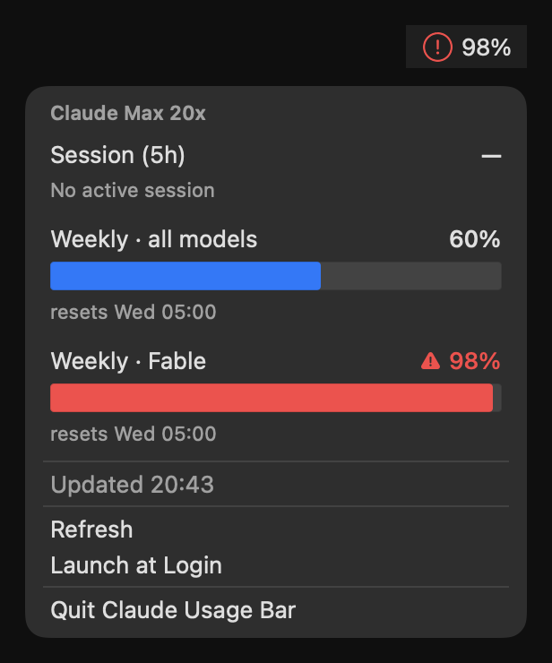

# Claude Usage Bar

See how much of your Claude plan you've used, right in your Mac's menu bar.



## Install

Paste this into Terminal:

```bash
curl -fsSL https://raw.githubusercontent.com/karannavani/claude-usage-bar/main/install.sh | bash
```

That's it. The installer checks your Mac has what it needs, builds the app, puts it in `~/Applications` and starts it. It takes about a minute. You're welcome to [read the script](install.sh) first.

To have it start whenever you log in, click the icon and choose **Launch at Login**.

### What you need

- **macOS 14 Sonoma or later.** On macOS 26 Tahoe or later, the menu bar ring also fills up as you use your limit.
- **[Claude Code](https://code.claude.com), signed in with a Claude subscription** such as Pro or Max. If you haven't yet, install Claude Code, run `claude`, then type `/login`. The app reads that login, so there's nothing else to set up.
- **Apple's Command Line Tools**, to build the app. If they're missing, the installer opens Apple's installer for you; run the command again once it's done.

## Using it

- **The menu bar** shows the limit you're closest to hitting. It turns **orange** as that limit gets high and **red with a ! symbol** when it's nearly used up. These follow Claude's own rating of each limit, or 75% and 90% when it doesn't give one.
- **Click it** to see every limit (the 5-hour session, your weekly limit across all models, and any per-model weekly limits) with how much you've used and when each resets.
- **It updates itself** every 2 minutes, when your Mac wakes, and when you open the menu. Choose **Refresh** (⌘R) to update straight away.
- **Greyed out** means the numbers might be out of date; the menu tells you why.
- **To remove it**, choose **Quit Claude Usage Bar**, or hold ⌘ and drag the icon out of the menu bar.

## Troubleshooting

| What you see | What to do |
| --- | --- |
| No icon in the menu bar | If you use a menu bar manager such as Bartender or Ice, look in its hidden section. On a crowded menu bar (especially beside a notch), macOS hides some icons; on macOS 26 or later, also check **System Settings → Menu Bar**. |
| "Not signed in to Claude Code" | Install Claude Code, run `claude`, then `/login`. |
| "Token expired" | Normal if you haven't used Claude Code for a while. Use Claude Code once and the app catches up within a minute. |
| "Rate limited" | Nothing to do; it waits and tries again on its own. |
| The installer says Swift 6 is needed | Update Xcode or the Command Line Tools in **System Settings → General → Software Update**. |

## Update

Run the install command again. It replaces the app with the latest version and restarts it.

## Uninstall

First untick **Launch at Login** if you turned it on. Then run:

```bash
curl -fsSL https://raw.githubusercontent.com/karannavani/claude-usage-bar/main/install.sh | bash -s -- --uninstall
```

## How it works

- It reads the login token that Claude Code keeps in your macOS keychain (the `Claude Code-credentials` item), using the built-in `security` tool.
- It asks `https://api.anthropic.com/api/oauth/usage` for your usage. This is the same endpoint Claude Code's `/usage` command uses. It isn't publicly documented and may change without notice, so the app is deliberately tolerant of fields it doesn't recognise.
- **It only ever reads the token.** Claude Code's tokens expire after a few hours and Claude Code renews them when you use it. The app never renews or changes them itself, so it can't interfere with Claude Code or sign you out.

### Privacy

Your token is only ever sent to `api.anthropic.com`. The app stores nothing, and has no analytics or other network traffic.

## Design

The app follows Apple's [Human Interface Guidelines](https://developer.apple.com/design/human-interface-guidelines/the-menu-bar) for menu bar extras, as of macOS 27:

- The icon is an SF Symbol drawn in the menu bar's own colours, so it adapts to light and dark menu bars and Liquid Glass. Its ring uses SF Symbols 7's Variable Draw to fill with your usage.
- Colour is used sparingly, for status only, and only on the icon. The percentage keeps the menu bar's standard text colour so it stays readable on any wallpaper. Critical also changes the icon's shape, so the state never depends on colour alone.
- Clicking opens a standard menu rather than a popover. Limits use the system's capacity gauge and follow your accent colour; the plan is a native section header.
- Every limit has a VoiceOver label and value, such as "Weekly, Fable: 98 percent used, resets Wednesday 05:00".
- You decide whether it's in your menu bar: ⌘-drag it out to remove it, and Launch at Login is off until you turn it on.

## Development

```bash
git clone https://github.com/karannavani/claude-usage-bar.git
```

```bash
cd claude-usage-bar && ./install.sh
```

Running `./install.sh` from a clone builds and installs that checkout. While working on it:

```bash
swift test
```

```bash
swift run
```

`swift run` starts the app without bundling it, so **Launch at Login** is unavailable there.

| Path | What's there |
| --- | --- |
| `Sources/UsageCore` | Credentials, response decoding, limit summary and formatting. No AppKit, and fully unit-tested. |
| `Sources/ClaudeUsageBar` | The menu bar item, menu, icon and SwiftUI limit rows. |
| `Support/Info.plist` | Bundle metadata (`LSUIElement`, so there's no Dock icon). |
| `scripts/build-app.sh` | Builds `build/Claude Usage Bar.app`; `--install` also copies it to `~/Applications` and launches it. |
| `install.sh` | The one-line installer and uninstaller. |

## Disclaimer

Unofficial and not affiliated with or endorsed by Anthropic. It relies on an undocumented endpoint, so it may stop working at any time.

## Licence

[MIT](LICENSE)
